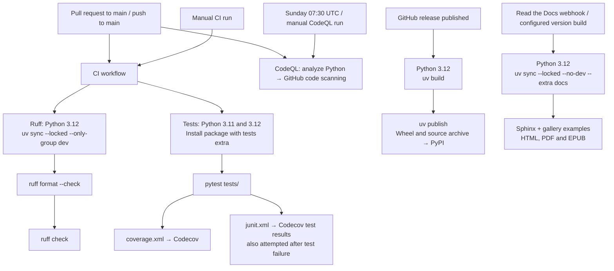

# Continuous integration

GitHub Actions checks pull requests targeting `main` and pushes to `main`.
uv installs locked dependencies and runs checks; Ruff handles lint and formatting.
`uv build` uses the native `uv_build` backend. The package version lives in
`pyproject.toml`; `src/sklvq/__about__.py` reads it from installed package metadata.



## Jobs and triggers

| Workflow | Trigger | Work |
| --- | --- | --- |
| `.github/workflows/pull-request.yml` | PR/push to `main`, or manual | Read-only format/lint checks; tests on Python 3.11 and 3.12; coverage and test-result uploads |
| `.github/workflows/codeql.yml` | PR/push to `main`, Sunday 07:30 UTC, or manual | Python security analysis, without a compilation step |
| `.github/workflows/pypi-publish.yml` | Published GitHub release | Build and publish the package |
| `.readthedocs.yml` | Read the Docs service configuration | Build documentation and execute gallery examples |

The Ruff job and both test jobs run independently on Ubuntu. Both Python test
jobs run even if one fails. A failing test command still fails its job;
the test-result upload is attempted afterward unless the job was cancelled.
Coverage uploads run after successful tests.

The old `master`/`develop` workflows for Black, coverage and TestPyPI have been
removed. There is one formatting tool (Ruff) and one test matrix. `uv.lock`
pins the project, test, documentation and Ruff dependencies. CI uses uv 0.13.5
and refuses to change the lockfile during synchronization.

## Run the same checks locally

Install [uv](https://docs.astral.sh/uv/getting-started/installation/), then:

```sh
uv sync --locked --only-group dev
uv run --no-sync ruff format --check src/sklvq/ examples/ tests/
uv run --no-sync ruff check src/sklvq/ examples/ tests/

uv sync --locked --python 3.11 --no-dev --extra tests
uv run --no-sync pytest --cov=src/sklvq --cov-report=xml --junitxml=junit.xml tests/

uv sync --locked --python 3.12 --no-dev --extra tests
uv run --no-sync pytest --cov=src/sklvq --cov-report=xml --junitxml=junit.xml tests/
```

Run one Python test command at a time: each writes the same report filenames.
Syncing a different Python version recreates the local `.venv`; uv installs
missing interpreters automatically. Use `uv sync --locked --extra tests --extra docs`
afterward to restore the full development environment.

Ruff uses the repository's `ruff.toml` and explicit basic error checks (E4, E7,
E9 and F). It does not inherit Hatch's broader lint policy. No commands in CI
auto-format or auto-fix source files.

## Repository and service settings

- `CODECOV_TOKEN` is used by the coverage and test-result uploads. Fork pull
  requests do not receive repository secrets; tokenless upload support depends
  on the Codecov project settings.
- `PYPI_API_TOKEN` is used only by the release-publishing workflow.
- Required status checks must be configured in GitHub branch protection/rulesets;
  these YAML files do not themselves prevent merging.
- Release publishing is triggered independently of CI. Publish a release only
  from a tested commit.
- Read the Docs versions and webhook triggers are configured in that service.
  GitHub Actions does not run or gate its documentation builds.
